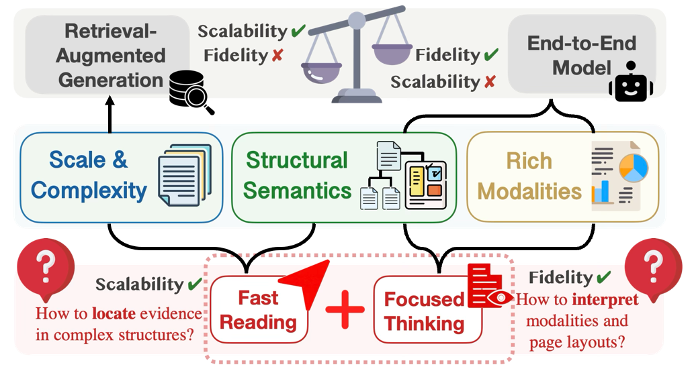
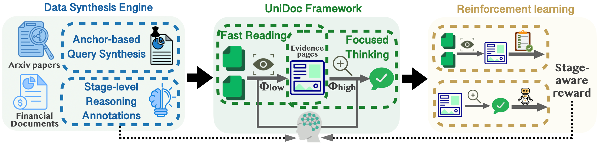
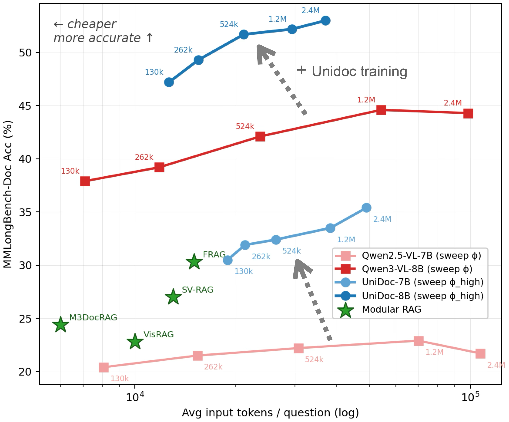
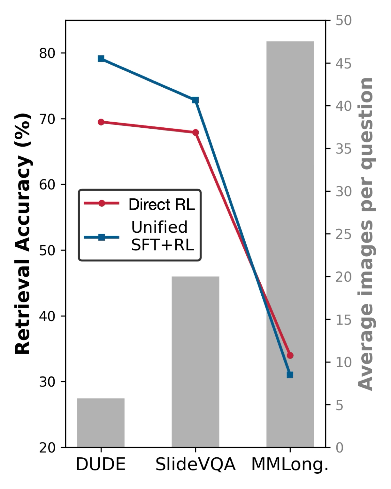
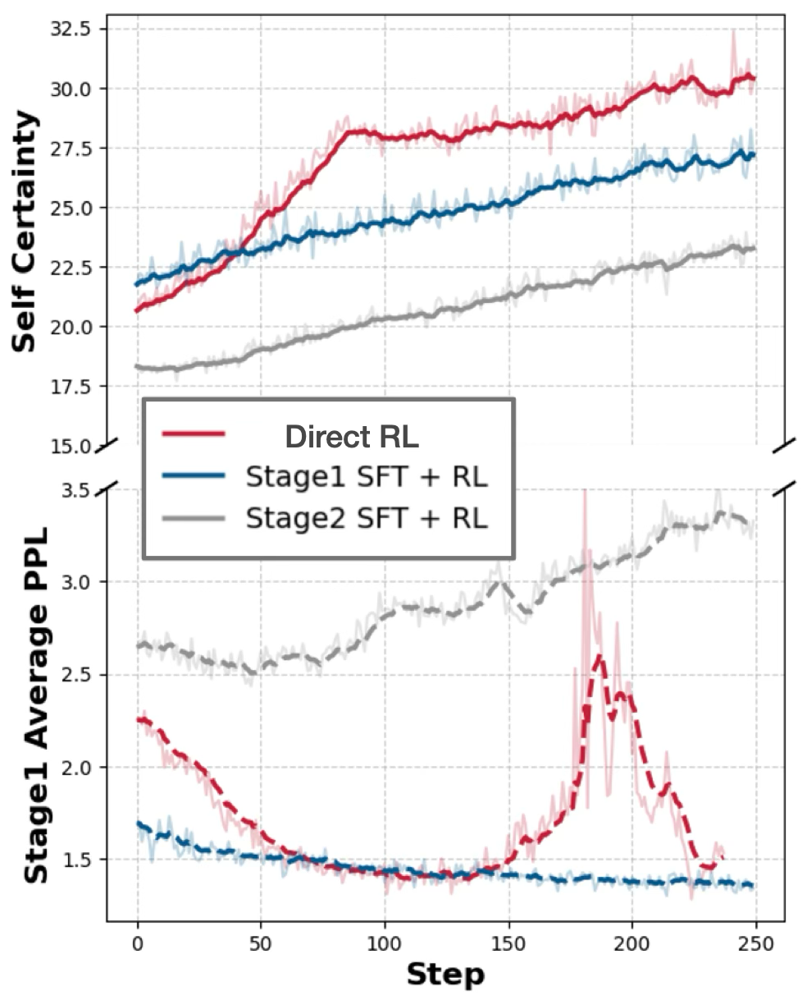
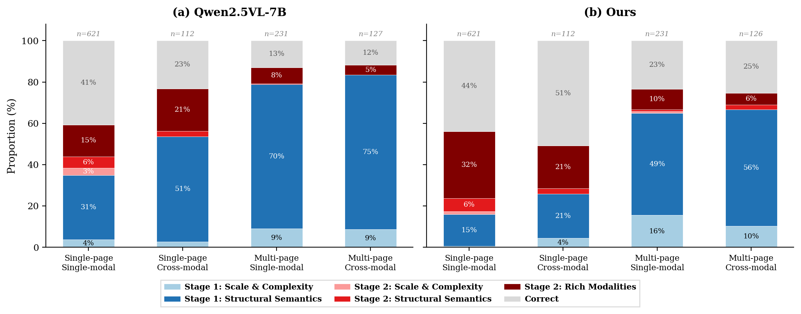

<h1 align="center">UniDoc: Towards Unified Thinking in Documents</h1>

<p align="center">
  <strong>A single model that skims every page of a long document at low resolution to locate evidence, then re-reads only the located pages at high resolution to reason over them.</strong>
</p>

<div align="center">
  <a href="https://openreview.net/forum?id=c4HyrJIiEa"></a>
  <a href="https://arxiv.org/abs/2512.12658"></a>
  <a href="https://huggingface.co/Racktic"></a>
  <a href="https://www.modelscope.cn/profile/jasperhaozhe"></a>
</div>

<p align="center">
  <a href="https://github.com/Racktic">Qixin Xu</a><sup>1*</sup>,
  <a href="https://haozheh3.github.io/">Haozhe Wang</a><sup>2*</sup>,
  <a href="https://cheliu-computation.github.io/">Che Liu</a><sup>3</sup>,
  <a href="https://facultyprofiles.hkust.edu.hk/profiles.php?profile=fangzhen-lin-flin">Fangzhen Lin</a><sup>2</sup>,
  <a href="https://wenhuchen.github.io/">Wenhu Chen</a><sup>4†</sup>
  <br>
  <sup>1</sup>Tsinghua University &nbsp;
  <sup>2</sup>Hong Kong University of Science and Technology &nbsp;
  <sup>3</sup>Imperial College London &nbsp;
  <sup>4</sup>University of Waterloo
  <br>
  <sup>*</sup>Equal contribution &nbsp; <sup>†</sup>Corresponding author
</p>

> [!NOTE]
> An earlier version of this work was released on arXiv under the name **CogDoc**. The repository keeps that name, along with directory names such as `train_cogdoc`.

## News

- **[2026.11]** UniDoc has been accepted to *Transactions on Machine Learning Research* (TMLR). The camera-ready version is available on [OpenReview](https://openreview.net/forum?id=c4HyrJIiEa).
- **[2026.02]** Code released: the data synthesis engine, SFT configurations, training data, and SFT checkpoints.
- **[2025.12]** Preprint released on [arXiv](https://arxiv.org/abs/2512.12658).

## Overview

<div align="center">
  
</div>

Answering questions over long, visually rich documents requires two things: cross-page structural reasoning and fine-grained visual understanding. Existing approaches give up one to get the other:

- **Retrieval-augmented methods** fragment documents and lose inter-page structure.
- **Monolithic vision-language models** preserve structure but scale poorly beyond a few pages.

UniDoc instead decouples the *perceptual resolutions* applied to evidence retrieval and to multimodal reasoning, rather than their architectures. This lets a single model combine the structural holism of monolithic processing with the efficiency of targeted retrieval.

On MMLongBench-Doc, UniDoc yields relative accuracy gains of **55.7%** on Qwen2.5-VL-7B and **16.9%** on Qwen3-VL-8B, while significantly reducing token cost relative to uniform high-resolution processing.

## Method

<div align="center">
  
</div>

UniDoc has two parts: a resolution-adaptive two-stage reasoning framework, and an anchor-grounded data synthesis engine that produces the training data the framework needs.

**Stage 1: Fast Reading (structure-aware evidence localization).**
- The model ingests the entire document at low resolution (at most 262,144 pixels per page).
- It reasons over heading hierarchies, section boundaries, and cross-references.
- It outputs a compact set of evidence pages, *k* ≪ *N*.

**Stage 2: Focused Thinking (high-resolution multimodal inference).**
- The *same* model re-processes only the localized pages at high resolution (at most 1,204,224 pixels per page).
- It cross-references table cells with text, interprets charts in context, and synthesizes an answer.

**Joint optimization with stage-aware rewards.**
- Both stages share one set of parameters, trained with GRPO on a joint dataset.
- Fast Reading is rewarded by rule-based set matching against the ground-truth pages.
- Focused Thinking is rewarded by an LLM judge.
- Advantage groups are formed strictly within each stage.

**Anchor-grounded data synthesis.**
- Figures, tables, and charts serve as information anchors.
- Each query is generated from an anchor together with the passages that reference it, which often sit on other pages.
- The engine produces 30K multi-hop instances with stage-level reasoning annotations for both stages.

## Main Results

MMLongBench-Doc, DUDE, SlideVQA, and MP-DocVQA. Among open-weight models, the best result is shown in **bold** and the second best is <u>underlined</u>.

MP-DocVQA<sup>†</sup> is a held-out benchmark: its training set is excluded from our training data, so it is not ranked. Subscripts give the gain over the corresponding base model.

| Model | Size | Paradigm | DUDE<br>ANLS | MMLongBench-Doc<br>Acc. | MMLongBench-Doc<br>F1 | SlideVQA<br>Acc. | SlideVQA<br>F1 | MP-DocVQA<sup>†</sup><br>Acc. |
|:--|:-:|:-:|:-:|:-:|:-:|:-:|:-:|:-:|
| *Avg. images per question* | | | *5.7* | *47.5* | | *20.0* | | *8.3* |
| GPT-4o mini | – | End-to-End | 46.5 | 28.6 | 29.4 | 48.1 | 60.7 | – |
| GPT-4o | – | End-to-End | 52.7 | 41.6 | 42.3 | 53.1 | 65.8 | – |
| GPT-4.1 | – | End-to-End | 50.2 | 45.6 | 49.7 | 61.5 | 74.7 | – |
| Claude-3.7-Sonnet | – | End-to-End | 58.1 | 33.9 | 38.4 | 62.9 | 76.3 | – |
| Qwen2.5-VL-7B-Instruct | 7B | End-to-End | 41.8 | 21.2 | 20.7 | 38.9 | 49.8 | 57.3 |
| Qwen2.5-VL-72B-Instruct | 72B | End-to-End | 44.5 | 24.9 | 24.6 | 38.8 | 54.4 | 64.2 |
| MiMo-VL-7B-SFT | 7B | End-to-End | 43.1 | 27.5 | 27.2 | 48.0 | 61.9 | 63.9 |
| InternVL3-8B | 8B | End-to-End | 43.4 | 29.6 | 28.8 | 51.6 | 64.4 | 83.3 |
| Qwen3-VL-8B | 8B | End-to-End | 45.4 | <u>44.9</u> | <u>43.7</u> | 46.3 | 57.9 | 72.8 |
| M3DocRAG | 10B | RAG | 39.5 | 21.0 | 22.6 | 48.8 | 57.9 | 84.4 |
| mPLUG-DocOwl2 | 8B | End-to-End | 45.6 | 13.4 | 8.9 | 25.4 | 30.4 | 69.4 |
| VisRAG | 8B | RAG | 43.1 | 18.8 | 18.3 | 50.9 | 52.4 | – |
| SV-RAG | 8B | RAG | 45.0 | 23.0 | 24.2 | 32.0 | 34.3 | 71.0 |
| Docopilot | 8B | End-to-End | 40.7 | 28.8 | 23.0 | 35.7 | 43.1 | 81.3 |
| VDocRAG | 8B | RAG | 44.0 | – | – | 42.0 | 44.0 | – |
| FRAG | 8B | RAG | 43.1 | 31.3 | 30.7 | 52.4 | 63.9 | 77.8 |
| **UniDoc-7B** (Qwen2.5-VL-7B) | 7B | Unified Thinking | <u>46.2</u><sub>+4.4</sub> | 33.0<sub>+11.8</sub> | 31.5<sub>+10.8</sub> | <u>58.3</u><sub>+19.4</sub> | <u>67.9</u><sub>+18.1</sub> | 75.0<sub>+17.7</sub> |
| **UniDoc-8B** (Qwen3-VL-8B) | 8B | Unified Thinking | **47.8**<sub>+2.4</sub> | **52.5**<sub>+7.6</sub> | **51.0**<sub>+7.3</sub> | **65.1**<sub>+18.8</sub> | **73.1**<sub>+15.2</sub> | 81.4<sub>+8.6</sub> |

## Efficiency

<div align="center">
  
</div>

The figure plots MMLongBench-Doc accuracy against the average number of input tokens per question, counting both UniDoc stages. Each curve sweeps the perceptual budget:
- for the monolithic VLMs, the single input resolution;
- for UniDoc, the Focused Thinking resolution.

At matched or lower token cost, UniDoc attains substantially higher accuracy than the monolithic model it is built on.

| Method (MMLongBench-Doc) | Acc. | Tokens / Doc | Wall-Clock (s / doc) |
|:--|:-:|:-:|:-:|
| Full high-res (all pages) | 21.2 | 49.8k | 11.0 |
| ColPali-RAG | 31.9 | 47.4k + 6.1k | 5.3 |
| UniDoc-7B | **33.0** | **26.3k** | 9.4 |

## Analysis

<details>
<summary><strong>Training strategy: Direct RL vs. Unified SFT+RL</strong></summary>

<br>

| Model | DUDE (ANLS) | MMLongBench-Doc (Acc.) | SlideVQA (F1) | MP-DocVQA (Acc.) |
|:--|:-:|:-:|:-:|:-:|
| UniDoc-7B (Direct RL) | 46.2 | **33.0** | 67.9 | 75.0 |
| Unified SFT+RL | **47.2** | 28.6 | **68.7** | **78.7** |

<div align="center">
  
  &nbsp;&nbsp;
  
</div>

The Unified SFT+RL policy exhibits a clear performance dichotomy:
- marginal gains on short-context tasks (e.g., +1.0 ANLS on DUDE);
- a significant degradation (−4.4 Acc.) on long-context MMLongBench-Doc.

Retrieval accuracy (left) confirms that this weakness is specific to long-context processing.

We hypothesize an internal optimization tension: the Unified SFT initialization forces the model to jointly learn two competing capabilities, namely the global, structure-level abstraction required by Stage 1 and the local, pixel-level scrutiny required by Stage 2. The RL training dynamics (right) are consistent with this hypothesis.

</details>

<details>
<summary><strong>Efficacy of stage-level reasoning annotations</strong></summary>

<br>

To isolate the reasoning annotations from this optimization tension, we train a separate specialist for each stage:
- **Stage 1:** the Stage 1 SFT + Stage 1 RL specialist outperforms other training recipes and strong RAG baselines in retrieval accuracy and recall.
- **Stage 2:** the Stage 2 SFT + Stage 2 RL specialist achieves an average +10.5 point gain over the Stage 2 Direct RL baseline.

The synthesized data therefore provides high-quality supervision for both stages individually. The degradation observed with Unified SFT+RL is not a failure of the data itself; we attribute it to optimization tension when jointly training both stages within a single model.

</details>

<details>
<summary><strong>Diagnostic error taxonomy</strong></summary>

<br>

<div align="center">
  
</div>

The two-stage decomposition makes errors attributable:
- each failure is traced to either Fast Reading or Focused Thinking;
- it is then categorized by document characteristic: Rich Modalities, Structural Semantics, or Scale and Complexity.

Across both models, retrieval errors related to structural semantics consistently dominate. Training substantially reduces them (e.g., 75% → 56% in Multi-page Cross-modal).

As more samples successfully reach the reasoning stage, fine-grained visual perception (Rich Modalities) is exposed as the new bottleneck.

</details>

## Getting Started

### Installation

```bash
git clone https://github.com/QixinXu/CogDoc.git
cd CogDoc
pip install -r requirements.txt
```

### Project Structure

```
CogDoc/
├── data_engine/               # Data synthesis engine
│   ├── src/
│   │   ├── core/              # Model client and utilities
│   │   ├── query_synthesis/   # Anchor-grounded query generation
│   │   └── thinking_synthesis/# Stage-level reasoning annotations
│   ├── configs/
│   └── scripts/
├── LlamaFactory-main/         # SFT framework
│   └── examples/train_cogdoc/ # SFT configurations
├── train/
│   └── RL/                    # Reinforcement learning (veRL)
└── eval/                      # Evaluation scripts
    ├── DUDE/
    ├── mmlongbench-doc/
    └── slidevqa/
```

### Data Synthesis

```bash
cd data_engine

# 1. Start the vLLM server
bash scripts/start_vllm_server.sh

# 2. Anchor-grounded query synthesis
python scripts/run_query_synthesis.py \
    --config-file configs/query_synthesis.yaml \
    --port 8000 \
    --figure --table

# 3. Stage-level reasoning annotation synthesis
python scripts/run_thinking_synthesis.py \
    --config-file configs/thinking_synthesis.yaml \
    --port 8000
```

### Supervised Fine-Tuning

```bash
cd LlamaFactory-main

# Stage 1: Fast Reading
llamafactory-cli train examples/train_cogdoc/stage1_stage2.yaml

# Stage 2: Focused Thinking
llamafactory-cli train examples/train_cogdoc/stage2.yaml
```

<details>
<summary><strong>SFT hyperparameters</strong></summary>

<br>

| Parameter | Stage 1 | Stage 2 |
|:--|:-:|:-:|
| Per-device batch size | 1 | 2 |
| Gradient accumulation | 4 | 4 |
| Learning rate | 1.0e-5 | 2.0e-6 |
| Epochs | 5 | 2 |
| LR scheduler | Cosine | Cosine |
| Warmup ratio | 0.1 | 0.1 |
| Precision | bf16 | bf16 |
| Image max pixels | 262,144 | 1,204,224 |

</details>

### Reinforcement Learning

RL training with veRL: coming soon.

### Evaluation

```bash
cd eval

# DUDE
python DUDE/evaluate_submission.py --pred_file <predictions.json>

# MMLongBench-Doc
python mmlongbench-doc/eval_score.py --input_file <predictions.jsonl>

# SlideVQA
python slidevqa/evaluate.py --pred_file <predictions.json>
```

## Release Status

| Component | Stage | Status | Link |
|:--|:-:|:-:|:--|
| Data engine | – | Released | [`data_engine`](data_engine) |
| SFT training | – | Released | [`LlamaFactory-main`](LlamaFactory-main) |
| RL training | – | Coming soon | – |
| SFT data | Stage 1 | Released | [ModelScope](https://www.modelscope.cn/models/jasperhaozhe/stage1_data) |
| SFT data | Stage 2 | Released | [ModelScope](https://www.modelscope.cn/models/jasperhaozhe/stage2_rlfullprompt) |
| RL data | Stage 1 | Released | [ModelScope](https://www.modelscope.cn/models/jasperhaozhe/stage1_difficulty_hierachy) |
| RL data | Stage 2 | Released | [ModelScope](https://www.modelscope.cn/models/jasperhaozhe/stage2_rlfullprompt) |
| SFT checkpoint | Stage 1 | Released | [Hugging Face](https://huggingface.co/Racktic/stage1_11k_2epoch) |
| SFT checkpoint | Stage 2 | Released | [ModelScope](https://www.modelscope.cn/models/jasperhaozhe/stage2_sftckpt-554) |
| RL checkpoint | Direct RL | Coming soon | – |
| RL checkpoint | SFT+RL | Coming soon | – |

## Citation

If you find this work useful, please cite:

```bibtex
@article{xu2026unidoc,
  title   = {UniDoc: Towards Unified Thinking in Documents},
  author  = {Xu, Qixin and Wang, Haozhe and Liu, Che and Lin, Fangzhen and Chen, Wenhu},
  journal = {Transactions on Machine Learning Research},
  issn    = {2835-8856},
  year    = {2026},
  url     = {https://openreview.net/forum?id=c4HyrJIiEa}
}
```

## Acknowledgements

This project builds on the following open-source projects:
- [Qwen2.5-VL](https://github.com/QwenLM/Qwen2.5-VL) and [Qwen3-VL](https://github.com/QwenLM/Qwen3-VL): base vision-language models.
- [LLaMA-Factory](https://github.com/hiyouga/LLaMA-Factory): supervised fine-tuning.
- [veRL](https://github.com/volcengine/verl): reinforcement learning.
- [vLLM](https://github.com/vllm-project/vllm): inference.

## License

This project is released under the MIT License.
