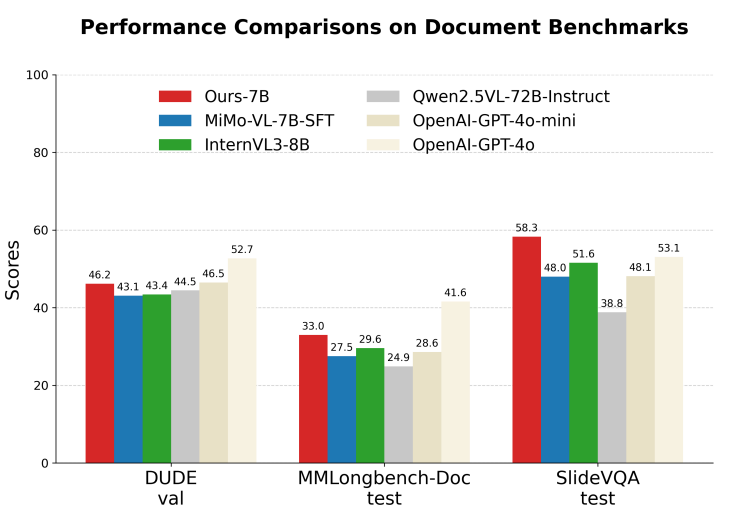
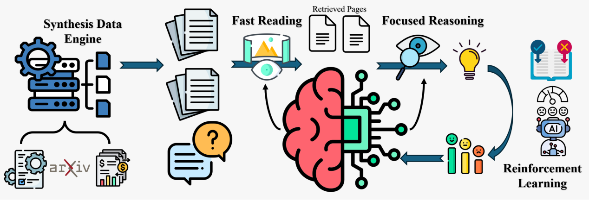

<div align="center">

# CogDoc: Towards Unified Thinking in Documents

<p align="center">
  <a href="https://arxiv.org/abs/2512.12658"></a>
  <a href="https://huggingface.co/Racktic"></a>
  <a href="https://www.modelscope.cn/profile/jasperhaozhe"></a>
  <a href="https://github.com/Racktic/CogDoc/blob/main/LICENSE"></a>
</p>

**A unified coarse-to-fine thinking framework for deep document reasoning**

[Qixin Xu](https://github.com/Racktic)<sup>1*</sup>, <sup>†</sup>[Haozhe Wang](https://haozheh3.github.io/)<sup>2*</sup>, [Che Liu](https://cheliu-computation.github.io/)<sup>4</sup>, [Fangzhen Lin](https://facultyprofiles.hkust.edu.hk/profiles.php?profile=fangzhen-lin-flin)<sup>2</sup>,<sup>†</sup>[Wenhu Chen](https://wenhuchen.github.io/)<sup>3</sup>

<sup>1</sup>Tsinghua University, <sup>2</sup>HKUST, <sup>3</sup>University of Waterloo, <sup>4</sup>Imperial College London

<sup>*</sup>Equal contribution &nbsp;&nbsp; <sup>†</sup>Corresponding author

</div>

---

## 📢 News

- 🔥 **[2025/02]** Codebase released! Data engine, SFT training, and checkpoints are now available.
- 📄 **[2025/12]** Paper released on [arXiv](https://arxiv.org/abs/2512.12658).

---

## 🌟 Highlights

<div align="center">

</div>

- 🏆 **State-of-the-Art Performance**: Our 7B model achieves SOTA among all 7-10B models and **outperforms GPT-4o** on SlideVQA.
- 🧠 **Human-Inspired Cognition**: A unified two-stage framework mimicking human reading patterns—"Fast Reading" for localization + "Focused Thinking" for deep reasoning.
- 📈 **Massive Improvements**: +55.7% on MMLongBench-Doc and +49.9% on SlideVQA over the base Qwen2.5-VL-7B model.
- 🔬 **Novel RL Insights**: We discover that direct RL outperforms SFT+RL by avoiding "policy conflict" in multi-mode models.

---

## 📖 Abstract

Current document reasoning paradigms are constrained by a fundamental trade-off between **scalability** (processing long-context documents) and **fidelity** (capturing fine-grained, multimodal details). To bridge this gap, we propose **CogDoc**, a unified coarse-to-fine thinking framework that mimics human cognitive processes:

1. **Fast Reading Phase** (Stage 1): Low-resolution perception for scalable information localization
2. **Focused Thinking Phase** (Stage 2): High-resolution perception for deep, grounded reasoning

We conduct a rigorous investigation into post-training strategies, demonstrating that **Direct Reinforcement Learning** outperforms RL with SFT initialization by avoiding "policy conflict."

---

## 🏗️ Framework

<div align="center">

</div>

Our methodology consists of three core components:

| Component | Description |
|-----------|-------------|
| **Data Synthesis Engine** | Generates complex, spatially-distributed queries from raw documents |
| **Two-Stage Framework** | Unified model operating in "Fast Reading" and "Focused Thinking" modes |
| **RL Training** | Direct reinforcement learning with hybrid reward signals |

---

## 📊 Main Results

| Model | Size | DUDE (ANLS) | MMLongBench (Acc.) | SlideVQA (F1) | MP-DocVQA (Acc.) |
|-------|------|-------------|-------------------|---------------|------------------|
| GPT-4o | - | 52.7 | 41.6 | 65.8 | - |
| GPT-4o mini | - | 46.5 | 28.6 | 60.7 | - |
| Qwen2.5-VL-7B-Instruct | 7B | 41.8 | 21.2 | 49.8 | 57.3 |
| Qwen2.5-VL-72B-Instruct | 72B | 44.5 | 24.9 | 54.4 | 64.2 |
| InternVL3-8B | 8B | 43.4 | 29.6 | 64.4 | 83.3 |
| **CogDoc (Ours)** | **7B** | **46.2** | **33.0** | **67.9** | **75.0** |

> Our 7B model surpasses GPT-4o mini and Qwen2.5-VL-72B on MMLongBench-Doc, and outperforms GPT-4o on SlideVQA.

---

## 🚀 Quick Start

### Installation

```bash
git clone https://github.com/Racktic/CogDoc.git
cd CogDoc
pip install -r requirements.txt
```

### Inference

```python
## pending, waiting for nodes
```

---

## 📁 Project Structure

```
CogDoc/
├── 📂 data_engine/              # Data Synthesis Pipeline
│   ├── src/
│   │   ├── core/                # Core utilities (model client, utils)
│   │   ├── query_synthesis/     # Query generation from documents
│   │   └── thinking_synthesis/  # Thinking pattern generation
│   ├── configs/                 # Configuration files
│   └── scripts/                 # Run scripts
│
├── 📂 LlamaFactory-main/        # SFT Training Framework
│   ├── examples/train_cogdoc/   # CogDoc training configs
│   └── ...
│
├── 📂 train/                    # Training Scripts                    
│   └── RL/                      # Reinforcement Learning (coming soon)
│
└── 📂 eval/                     # Evaluation Scripts
    ├── DUDE/
    ├── mmlongbench-doc/
    └── slidevqa/
```

---

## 📦 Release Progress

### Code Release

| Component | Status | Link |
|-----------|--------|------|
| Data Engine | ✅ Released | [data_engine](https://github.com/Racktic/CogDoc/tree/main/data_engine) |
| SFT Training | ✅ Released | [LlamaFactory-main](https://github.com/Racktic/CogDoc/tree/main/LlamaFactory-main) |
| RL Training | ⏳ Coming Soon | - |

### Data Release

| Dataset | Stage | Status | Link |
|---------|-------|--------|------|
| SFT Data | Stage 1 | ✅ Released | [ModelScope](https://www.modelscope.cn/models/jasperhaozhe/stage1_data) |
| SFT Data | Stage 2 | ✅ Released | [ModelScope](https://www.modelscope.cn/models/jasperhaozhe/stage2_rlfullprompt) |
| RL Data | Stage 1 | ✅ Released | [ModelScope](https://www.modelscope.cn/models/jasperhaozhe/stage1_difficulty_hierachy) |
| RL Data | Stage 2 | ✅ Released | [ModelScope](https://www.modelscope.cn/models/jasperhaozhe/stage2_rlfullprompt) |

### Checkpoint Release

| Model | Stage | Status | Link |
|-------|-------|--------|------|
| SFT Checkpoint | Stage 1 | ✅ Released | [HuggingFace](https://huggingface.co/Racktic/stage1_11k_2epoch) |
| SFT Checkpoint | Stage 2 | ✅ Released | [ModelScope](https://www.modelscope.cn/models/jasperhaozhe/stage2_sftckpt-554) |
| RL Checkpoint | ZeroRL | ⏳ Coming Soon | - |
| RL Checkpoint | SFT+RL | ⏳ Coming Soon | - |

---

## 🔧 Training

### Data Synthesis

Generate training data using our data engine:

```bash
cd data_engine

# 1. Start vLLM server
bash scripts/start_vllm_server.sh

# 2. Run query synthesis
python scripts/run_query_synthesis.py \
    --config-file configs/query_synthesis.yaml \
    --port 8000 \
    --figure --table

# 3. Run thinking pattern synthesis
python scripts/run_thinking_synthesis.py \
    --config-file configs/thinking_synthesis.yaml \
    --port 8000
```

### Supervised Fine-Tuning

Train with LLaMA-Factory:

```bash
cd LlamaFactory-main

# Stage 1: Fast Reading
llamafactory-cli train examples/train_cogdoc/stage1_stage2.yaml

# Stage 2: Focused Thinking  
llamafactory-cli train examples/train_cogdoc/stage2.yaml
```

<details>
<summary><b>Training Hyperparameters (Stage 1)</b></summary>

| Parameter | Value |
|-----------|-------|
| Per device batch size | 1 |
| Gradient accumulation | 4 |
| Learning rate | 1.0e-5 |
| Epochs | 5 |
| LR scheduler | Cosine |
| Warmup ratio | 0.1 |
| Precision | bf16 |
| Image max pixels | 262144 |

</details>

<details>
<summary><b>Training Hyperparameters (Stage 2)</b></summary>

| Parameter | Value |
|-----------|-------|
| Per device batch size | 2 |
| Gradient accumulation | 4 |
| Learning rate | 2.0e-6 |
| Epochs | 2 |
| LR scheduler | Cosine |
| Warmup ratio | 0.1 |
| Precision | bf16 |
| Image max pixels | 1204224 |

</details>

### Reinforcement Learning

```bash
# Coming soon - RL training with veRL
```

---

## 📈 Evaluation

Evaluate on document understanding benchmarks:

```bash
cd eval

# DUDE benchmark
python DUDE/evaluate_submission.py --pred_file <predictions.json>

# MMLongBench-Doc
python mmlongbench-doc/eval_score.py --input_file <predictions.jsonl>

# SlideVQA
python slidevqa/evaluate.py --pred_file <predictions.json>
```

---

## 🔍 Key Findings

### Policy Conflict in Multi-Mode Models

Our analysis reveals a critical insight: **SFT initialization creates policy conflict** in unified models.

<!-- <div align="center">

</div> -->

- **SFT+RL**: Marginal gains on short-context tasks but **-4.4% degradation** on long-context MMLongBench-Doc
- **Direct RL**: Learns both "Fast Reading" and "Focused Thinking" concurrently without conflict
- **Root Cause**: Stage 1 (global view) and Stage 2 (local view) objectives are inherently antagonistic

### Thinking Patterns Are Effective

When evaluated as specialist models:
- Stage 1 SFT+RL: **+18.5%** improvement in retrieval accuracy
- Stage 2 SFT+RL: **+10.4%** average gain over ZeroRL baseline

> The patterns are highly effective individually—the challenge lies in their fusion within a unified model.

---

## 📋 Citation

If you find our work useful, please consider citing:

```bibtex
@article{xu2025cogdoc,
  title={CogDoc: Towards Unified Thinking in Documents},
  author={Xu, Qixin and Wang, Haozhe and Liu, Che and Lin, Fangzhen and Chen, Wenhu},
  journal={arXiv preprint arXiv:2512.12658},
  year={2025}
}
```

---

## 🙏 Acknowledgements

This project builds upon the following excellent works:

- [Qwen2.5-VL](https://github.com/QwenLM/Qwen2.5-VL) - Base vision-language model
- [LLaMA-Factory](https://github.com/hiyouga/LLaMA-Factory) - Training framework
- [veRL](https://github.com/volcengine/verl) - RL training platform
- [vLLM](https://github.com/vllm-project/vllm) - Fast inference engine

---

## 📄 License

This project is released under the [MIT License](LICENSE).

---

<div align="center">
<p>⭐ If you find this project helpful, please give us a star!</p>

**[Paper](https://arxiv.org/abs/2512.12658)** | **[Code](https://github.com/Racktic/CogDoc)** | **[Models](https://huggingface.co/Racktic)** | **[Data](https://www.modelscope.cn/profile/jasperhaozhe)**

</div>
